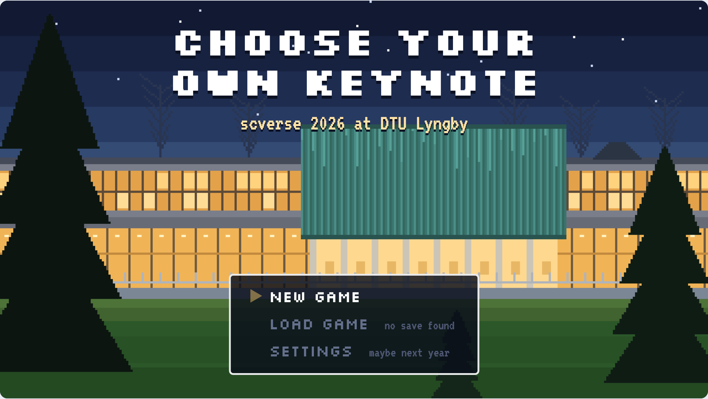

# Choose your own keynote: [scverse conference 2026](https://scverse.org/conference2026/)

My keynote at the [scverse conference 2026](https://scverse.org/conference2026/) (12–14 October, DTU, Copenhagen), presented as a pixel-art side-scrolling game. There were no slides. I walked around a pixel version of the venue, and the audience voted on their phones for which topic came next.



## Play it

**[Play the game in your browser](https://ewels.github.io/scverse2026-keynote/)**. It needs no install and no sign-in.

| Key | Does |
| --- | --- |
| <kbd>←</kbd> <kbd>→</kbd> | Walk, choose and step through the talk |
| <kbd>Space</kbd> / <kbd>Enter</kbd> / <kbd>B</kbd> | Take action: talk, open doors, poke things |
| <kbd>F</kbd> | Full screen |
| <kbd>R</kbd> | Back to the menu |

Each room in the venue holds one topic:

- 🎓 Why bother writing software? (the opener, in the lecture theatre)
- 🧬 Community building with nf-core
- 🦀 rewrites.bio
- 🤖 Building tools for agents
- 📊 MultiQC
- 🎮 Side projects
- 📚 Building awesome docs sites

There are easter eggs hidden around the venue. Have fun finding them!

## How it worked on the day

- 🗳️ **Live ranking.** The audience scanned a QR code and ranked the topics on their phones. Bars beside the game showed which room was most wanted next.
- 🙋 **Questions.** People sent and upvoted questions. When I put a question on screen, a character in the game walked up with a "?" to ask it.
- 👏 **Reactions.** Claps, hearts and coffees from phones floated up over the game. When enough came in at once, the pixel crowd stood up.

All of the code was written by Claude Opus 5.5. It is plain HTML, CSS and JavaScript, and all the art is drawn in code. There is no build step and there are no image files. A small [Cloudflare Worker](https://developers.cloudflare.com/workers/) synced the votes and questions during the talk. Now the game runs on GitHub Pages with the live features off.

## Run it yourself

Open `docs/index.html` in a browser. That's it.

To run it with the live features, start the Worker locally:

```sh
cd worker && cp .dev.vars.example .dev.vars && npx wrangler dev
```

Then open the stage at `http://localhost:8787/?stage&key=dev`, the audience page at `/join/` and the moderator page at `/mod/?key=dev`.

<details>
<summary>Deploying, presenting and testing</summary>

### What's where

- `docs/`: the static site. `index.html` is the game, `content.js` holds the talk's content (characters, topics, beats), `places/` has one script per room, `join/` is the audience page and `mod/` is the moderator page.
- `worker/`: the Cloudflare Worker and one Durable Object that holds the live state. It also serves `docs/`.

| Address | Who | What |
| --- | --- | --- |
| `/` | Anyone | The game |
| `/?stage&key=KEY` | Presenter, on the laptop | The game plus QR code, ranking bars and upcoming questions |
| `/join/` | Audience | Rank the topics, send and vote on questions |
| `/mod/?key=KEY` | Presenter, on a phone | Put questions on screen, mark them answered, dismiss them |

### Deploy

The presenter key and the Worker's address go in `.env`, which git ignores:

```sh
cp .env.example .env
sed -i '' "s/^PRESENTER_KEY=.*/PRESENTER_KEY=$(openssl rand -hex 24)/" .env
cd worker && npm install && npx wrangler login && npx wrangler deploy
sed -n 's/^PRESENTER_KEY=//p' ../.env | npx wrangler secret put PRESENTER_KEY
```

Put the printed address in `KEYNOTE_URL` in `.env`. After that, GitHub Actions deploys every push to `main` that changes `docs/` or `worker/`, once the tests pass. It needs the `CLOUDFLARE_ACCOUNT_ID` and `CLOUDFLARE_API_TOKEN` repository secrets. A deploy drops every phone for a moment, so don't push during the talk.

### Present

Run `./present.sh` (needs [gum](https://github.com/charmbracelet/gum)) and pick **Start the talk**. It opens the stage and copies the moderator link to the clipboard, so the key never shows on screen. Run it before the projector mirrors your screen. Press F for full screen, reset the rehearsal votes, and open the moderator link on your phone. The dots turn green when everything is connected. If the connection drops, the game carries on.

### Move to GitHub Pages afterwards

1. Make the repo public, then set Pages to deploy from `main` and `/docs`.
2. Remove the `deploy` job from `.github/workflows/test.yml`.
3. Delete the Worker with `npx wrangler delete`, or leave it: it costs nothing when idle.

### Tests

```sh
npm install && npm --prefix worker install && npx playwright install chromium   # once
npm test
```

The Playwright tests play the game from disk, then drive the stage, two phones and the moderator page against a local Worker. Add `?debug` to the game's address to skip the intro and expose `window.__game` and `window.__live`. Limits (question length, cooldowns and so on) are at the top of `worker/src/worker.js`.

</details>

## Credits

Made by [Phil Ewels](https://github.com/ewels). Fonts: Silkscreen and VT323, SIL Open Font License 1.1. QR codes: qrcode-generator by Kazuhiko Arase, MIT licence.
